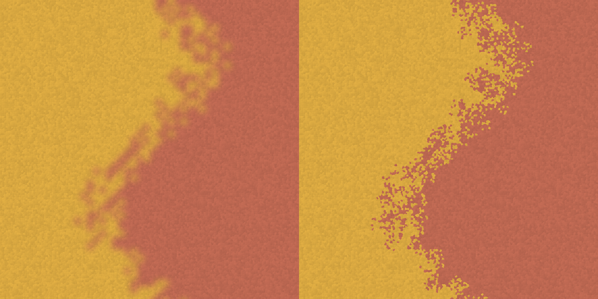
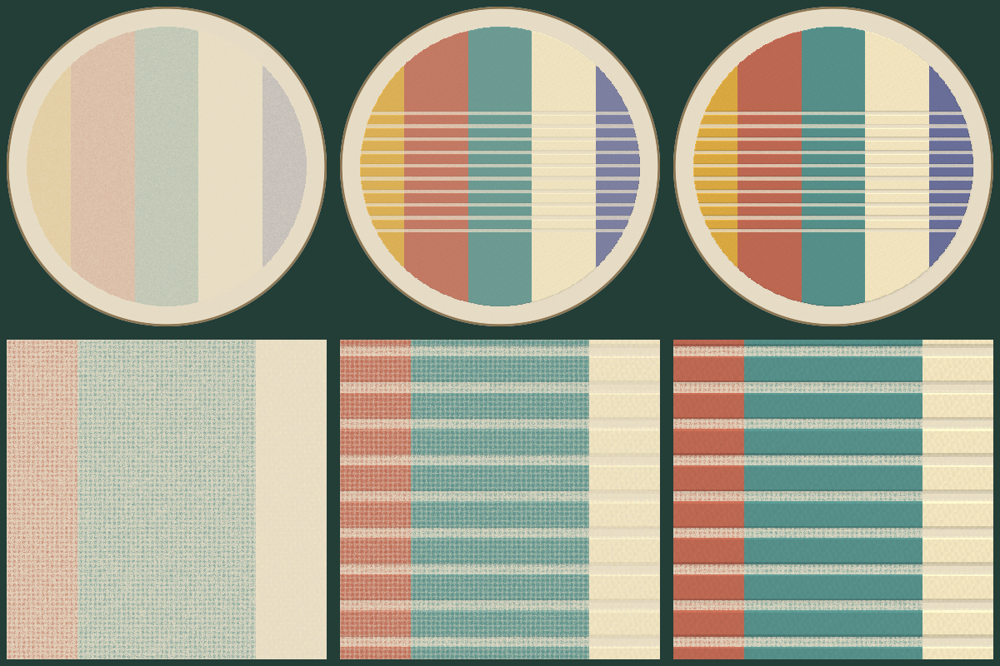
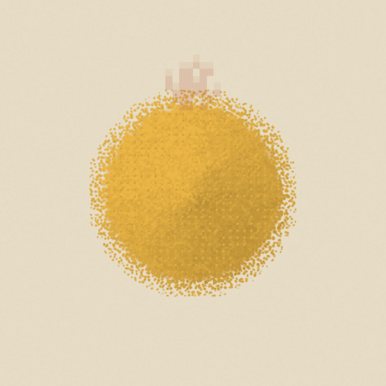

# Sand depth rendering

## Completed section colors

Completing a section requires at least 98% of its cells to have three or more
settled layers and the guide color on top. Completion assists its color.
Every section starts with an invisible lip around its perimeter, including edges
shared with other colors. Adjoining sections share one lip per grid edge. The
lip holds the bottom three layers, and higher sand can spill over. During
painting, the vacuum preserves settled sand in completed sections while
cleaning unfinished sections and gaps. It can also pick up rolling sand within
reach, including inside completed sections.

Occupied cells in a completed section display its guide color, including moving
grains at their current position. Grains recover their original appearance in a
gap or an unfinished section. Empty cells stay empty.

Section completion remains earned even after its sand is disturbed or removed.
Finishing the whole painting requires all sections to be complete and meet
the 98% coverage threshold, with clean gaps and a settled second after the tools
and moving grains stop.

Choosing **Let go** bakes each completed section's color through every occupied
layer before turning color assistance and vacuum protection off. Intact lips
continue to hold the edge until a sweep or vacuum stroke touches it. Each stroke
opens only the segments under its path, so sand can spill there while the rest
of the picture stays supported. Undo restores the lip state from before the
stroke. Undoing **Let go** also restores the original pigments and assistance.
Version 3 saves record the intact segments. Painting saves rebuild lips around
all sections when loaded. Released saves retain their saved openings.

**Tools > Mandala > Run Completion Color Checks** covers temporary coloring,
earned completion, coverage, movement inside colored areas, release
during motion, full-depth baking, undo, clear, persistence, and old saves.
**Run Section Lip Checks** verifies shared color edges, cleanup, overflow, local
sweep and vacuum openings, undo, and saved edges.
**Run Completion Color Rendering Checks** verifies actual GPU output and requires
the completed picture to be pixel-identical immediately before and after baking.

## Surface depth

Sand height now controls coverage as well as surface lighting:

- A thin deposit shows scattered colored grains with the tray visible between them.
- Two layers cover more of the tray while leaving visible gaps between grains.
  Three layers give full coverage.
- Deep layers add lit slopes and short shadows within the sand that reveal
  raised edges and lower furrows. Exposed tray stays unshadowed beside piles,
  so vacuuming beside dense piles leaves a clean surface.

The five palette hues stay consistent for color matching. Grain placement,
spacing, size, and shape vary reproducibly in tray coordinates. Panning and
zooming reveal the same grains; unresolved grains blend toward their average
coverage to limit aliasing. Grain centers can move across nearly their full seed
cell, with independent size, aspect, and rotation. Neighboring grains are evaluated
together so they can cross cell boundaries without rectangular clipping. Each
whole grain takes its material from its own center. A positive cubic B-spline
reconstructs pigment, height, and occupancy from the cell field, smoothing cleared
outlines and boundaries between colors without ringing. Four bilinear samples per
field provide the reconstruction. Height is normalized by occupancy before grain
coverage is evaluated; a separate occupancy mask controls the contour. Overfilling
an opaque section therefore cannot change its silhouette or create a band of
sparse grain holes along its edge. Display-pixel antialiasing keeps the reconstructed
outline crisp, with a small continuous grain-scale variation that fades when
unresolved. The simulation grid and saved sand are unchanged.
Empty cells show the clean tray, including beside tall piles and between sparse grains.

Dense sand retains fine, irregular grain facets with subtle brightness variation.
Each resolved facet chooses one nearby occupied cell's top color using stable,
tray-anchored randomness and the surface's positive B-spline weights. Touching
colors therefore appear as distinct colored grains rather than cloudy blended
pigment. Empty sampled cells fall back to the occupancy-normalized surface color,
so color selection cannot introduce dark grains or holes at an exposed contour.
The grain colors and lighting fade toward the filtered surface when too small to
resolve, limiting aliasing. They do not open gaps in opaque coverage. Slope lighting
compares neighboring sand surfaces, treating empty neighbors as exposed contours
rather than steep slopes. Gentler slope contrast reduces the thick painted bevel
at cleared edges while retaining shadows within sand-covered grooves.



This close-up uses the same simulated surface in both panels: the previous blended
pigment is on the left, and individual grain colors are on the right. This is an
isolated GPU-rendered material fixture, not a player's painting. The simulation
remains 440 × 440 with 24 layers. No texture allocations or uploads were added;
resolved dense grains use one extra material texture sample per shaded pixel,
after the existing nearest-facet search. Unresolved dense grains skip that sample.
Target-device frame-time impact has not been measured.

Mixed-color GPU validation used alternating gold and terracotta cells to verify
that resolved grains retain both original hues (100% of sampled pixels, split
49.9%/50.1%), remain stable over time and panning, and preserve their colors when
zooming at equal sampling density (one rounded boundary pixel in 59,536 samples).
At a 414-pixel full-tray view, the output matches the previous shader within
readback tolerance. Height and layer arrays remain byte-for-byte unchanged.



This comparison predates the three-layer coverage change and shows one, three,
and five layers from left to right. Full tray views are above, with close views
below. The same five-layer
depressions run through the middle and right samples, retaining at least one
layer of sand so lower surfaces can be compared with their shoulders. These are
rendering fixtures, not screenshots of a player's painting.

`SandTexture` derives slope lighting and short shadows from the existing height
field with an upper-left light direction. The surface shader uses uploaded height
to blend tray and grain coverage. The simulation, tools, color stacks, protection,
completion rules, save format, and undo are unchanged by this visual update.

## Fuller pouring

Pouring deposits a dense core directly beneath the brass tip with a lighter fringe.
The nozzle radius is `4 * GridScale`, down from `12 * GridScale`, and the incoming
flow is 50% higher. Flow is normalized by footprint area. A held pour can reach
the stack limit near the tip while sand continues to settle outward. Contact is
integrated along moving strokes so fast drags keep a continuous trail and
comparable volume at different sampling rates.
Holding the tip builds a pile instead of distributing every new grain into the
lowest cells across the whole footprint. Falling grains, original colors,
completed-section coloring, stack limits, saves, and undo continue to apply. Settling can
continue beyond the nozzle and after the stroke ends.

Settling examines 16 nearby downhill directions, including diagonal and short
rolling paths, and chooses the steepest available slope. Stable sub-layer surface
roughness resolves integer-height ties equally in every direction, rather than
adding a rounding penalty only to diagonal and rolling paths. This reduces axis
bias in the opaque pile body as well as the sparse fringe. Transfers require at
least a two-layer drop, so the roughness does not shuffle isolated residue.
Short rolling paths respect intervening raised barriers.
Direction tie-breaking varies across cells and simulation steps. Raised barriers
and the tray boundary still constrain spreading.

**Tools > Mandala > Run Round Pile Checks** verifies centered, roughly circular
outward growth during 2-, 6-, and 12-second stationary pours at two tip alignments,
and round outer and opaque contours during holds up to 60 seconds, as well as
mass/color conservation and the release tail. The existing 24-layer stack limit
still bounds how much an indefinitely held pour accepts;
this remains a discrete height-field approximation of sand.


These isolated, unobstructed stationary pours show outward growth from left to
right at the same view scale. The contour retains small grain-level variations.

**Tools > Mandala > Run Pour Checks** verifies increased total flow, a thicker
center, a feathered edge, moving trail continuity, sampling consistency, landing,
snapshots, completion assistance, color changes during a pour, and saturated piles.

## Visible downhill rolling

Downhill transfers now take time. A grain leaves its original stack, travels
between neighboring cells at 20–42 cells per second depending on slope, then
lands in a reserved destination slot. A source can have one outgoing transfer
in flight; an arriving grain cannot begin another hop in that same tick. The
simulation reads a consistent snapshot of occupied and reserved heights for its
downhill choices, using a resting slope of 1.5 layers per cell and the existing
stable surface roughness. The four extra immediate settling scans during pouring
have been removed. The same settling pass continues after release.

Only moving surface grains need fractional positions. Settled sand remains on
the 440 × 440 grid with 24 layers. A dynamic mesh draws up to 4,096 small shaded
grains directly into the visible tray texture, preserving fractional movement
and original colors without another texture upload. When that budget fills,
additional material waits in place. The mesh and simulation bookkeeping add
memory and CPU/GPU work; device frame-time impact has not been measured.



This isolated Unity-rendered preview pours terracotta onto an existing gold hill,
then lets it roll and settle after release. The simulation advances at 60 Hz;
the preview samples it at 20 frames per second.

`Mass()` includes rolling material and excludes airborne pour grains, as before
for the latter. Snapshots land moving grains at their reserved destinations so
saving and undo preserve every accepted grain without changing the save format.
Clear and restore discard all transfers and reservations. The vacuum can capture
rolling grains and turn them into its existing removal animation. A destination
accepted before departure retains its reservation if a section completes in flight;
new transfers respect stack capacity and intervening raised barriers. Completion waits
until both airborne and rolling grains finish, and the final settled state is saved.

**Tools > Mandala > Run Rolling Sand Checks** checks timed motion, slope-dependent
speed, movement after release, no same-tick cascades, exact material/color
conservation, reservations, saves, undo, clear, completion assistance, vacuuming in flight,
particle-budget saturation, stack capacity, and completion timing.
**Tools > Mandala > Run Rolling Sand Rendering Checks** reads actual GPU output to
check position and Y orientation, quarter-cell motion, opaque tray coverage,
cached settled surfaces, and clearing the final rolling frame.

## Softer pouring animation

The animation shows one grain from each pair of stable grain IDs, while all
simulated grains still land. The visible subset stays consistent as grains land
and the particle list is compacted. Visible grains peak at 60% opacity, fade in
over 30 milliseconds, and fade out during the final 1.5 cells of their fall.
Fractional falling positions blend between neighboring rows to soften movement.
Overlapping pour grains stay translucent instead of building into opaque pixels.

Active pouring and its airborne tail redraw at up to 60 Hz. Whenever the simulation
changes the sand, its color/height and section-feedback fields refresh on the next
displayed frame, bypassing the animation deadlines. This shows intermediate landing
and settling states at up to the simulation's 60 Hz rate, including after release.
Multiple simulation steps within one displayed frame upload only their latest state.
Animation-only frames can still reuse the settled surface, with the existing 30 Hz
feedback refresh and immediate refresh for view changes and undo. The final airborne
frame clears automatically after release.
The fast flow, deposited volume, and palette are retained.

**Tools > Mandala > Run Pour Animation Checks** verifies stable half-density,
opacity, actual GPU output, fades, list compaction without flicker, fractional
movement, release cleanup, cached surface refresh, and unchanged material mass.
An isolated runtime check verifies that surface changes bypass both future render
deadlines, animation-only frames can reuse the surface, and every grain lands after
release.


The original opaque grain treatment is on the left and the softer animation on
the right. Both use the same simulation state and deposited sand.

Run **Tools > Mandala > Run Sand Depth Rendering Checks** in Unity, or:

```sh
unity command script eval --caller plugin --skill unity-cli \
  'return Mandala.Game.Editor.MandalaRenderingChecks.RunDepth();'
```

Checks render isolated trays and read the actual GPU output. They verify sparse
one-layer residue, increased coverage at two layers, full coverage at three layers,
stable grains over time, panning and zooming,
stable dense grain detail, soft exposed edges, clean tray beside low and tall piles,
shaded sand furrows, all five palette hues, identical curved contours at three and
24 layers, touching colors without exposed tray seams, unchanged
simulation material, and removal of all residual shading after clearing. The
existing rendering and color-highlight checks also pass in Unity 6000.6.9f1.

**Tools > Mandala > Run Sand Grain Distribution Checks** measures spatial
correlation in GPU-rendered single-layer sand at grain and simulation cell
spacings, in both axes. This catches regular grain rows and columns that the
coverage and zoom checks alone cannot detect.
