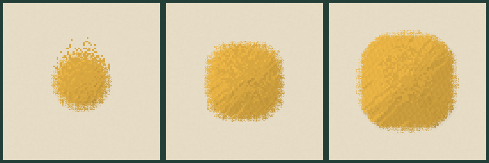

# Sand depth rendering

Sand height now controls coverage as well as surface lighting:

- A thin deposit shows scattered colored grains with the tray visible between them.
- Coverage fills in gradually across layers two, three, and four; five layers
  fully cover the tray.
- Deep layers add lit slopes and short shadows that reveal
  raised edges and lower furrows.

The five palette hues stay consistent for color matching. Grain placement,
spacing, size, and shape vary reproducibly in tray coordinates. Panning and
zooming reveal the same grains; unresolved grains blend toward their average
coverage to limit aliasing. Continuous layers keep the simulation's cell texture.
Empty cells show the tray, and removing a pile also removes its shadow.


This isolated material comparison shows one, three, and five layers from left
to right. Full tray views are above, with close views below. The same five-layer
depressions run through the middle and right samples, retaining at least one
layer of sand so lower surfaces can be compared with their shoulders. These are
rendering fixtures, not screenshots of a player's painting.

`SandTexture` derives slope lighting and short shadows from the existing height
field with an upper-left light direction. The surface shader uses uploaded height
to blend tray and grain coverage. The simulation, tools, color stacks, protection,
completion rules, save format, and undo are unchanged by this visual update.

## Fuller pouring

Pouring now deposits a denser core directly beneath the tip with a lighter fringe.
The radial profile keeps the same average volume over the footprint before
applying a 1.5× flow increase. Contact is integrated along moving strokes so fast
drags keep a continuous trail and comparable volume at different sampling rates.
Holding the tip builds a pile instead of distributing every new grain into the
lowest cells across the whole footprint. Falling grains, original colors,
protected sections, stack limits, saves, and undo continue to apply.

Settling examines 16 nearby downhill directions, including diagonal and short
rolling paths, and chooses the steepest available slope. Distances include stable
whole-layer rounding so a held pour spreads approximately circularly instead of
forming a diamond or square. Short rolling paths respect intervening protected
cells and raised barriers.
Direction tie-breaking varies across cells and simulation steps. Protected sand
and the tray boundary still constrain spreading.

**Tools > Mandala > Run Round Pile Checks** verifies centered, roughly circular
outward growth during 2-, 6-, and 12-second stationary pours at two tip alignments,
as well as mass/color conservation and the release tail.



These isolated, unobstructed stationary pours show outward growth from left to
right at the same view scale. The contour retains small grain-level variations.

**Tools > Mandala > Run Pour Checks** verifies increased total flow, a thicker
center, a feathered edge, moving trail continuity, sampling consistency, landing,
snapshots, protection, color changes during a pour, and saturated piles.

Run **Tools > Mandala > Run Sand Depth Rendering Checks** in Unity, or:

```sh
unity command script eval --caller plugin --skill unity-cli \
  'return Mandala.Game.Editor.MandalaRenderingChecks.RunDepth();'
```

Checks render isolated trays and read the actual GPU output. They verify sparse
one-layer residue, a visible increase at every layer through five, full five-layer coverage,
stable grains over time, panning and zooming,
stronger shadows from taller piles, lit slopes, all five palette hues, unchanged
simulation material, and removal of all residual shading after clearing. The
existing rendering and color-highlight checks also pass in Unity 6000.6.9f1.
