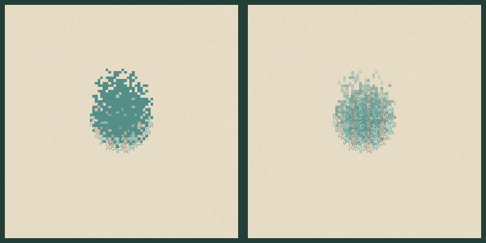

# Sand depth rendering

Sand height now controls coverage as well as surface lighting:

- A thin deposit shows scattered colored grains with the tray visible between them.
- Coverage fills in gradually across layers two, three, and four; five layers
  fully cover the tray.
- Deep layers add lit slopes and short shadows within the sand that reveal
  raised edges and lower furrows. Exposed tray stays unshadowed beside piles,
  so vacuuming around protected sections leaves a clean surface.

The five palette hues stay consistent for color matching. Grain placement,
spacing, size, and shape vary reproducibly in tray coordinates. Panning and
zooming reveal the same grains; unresolved grains blend toward their average
coverage to limit aliasing. Grain centers can move across nearly their full seed
cell, with independent size, aspect, and rotation. Neighboring grains are evaluated
together so they can cross cell boundaries without rectangular clipping. Each
whole grain takes its material from its own center. A positive cubic B-spline
reconstructs pigment, height, and occupancy from the cell field, smoothing cleared
outlines and boundaries between colors without ringing. Four bilinear samples per
field provide the reconstruction. Height is normalized by occupancy before grain
coverage is evaluated; a separate occupancy mask controls the contour. Overfilling
an opaque section therefore cannot change its silhouette or create a band of
sparse grain holes along its edge. Display-pixel antialiasing keeps the reconstructed
outline crisp, with a small continuous grain-scale variation that fades when
unresolved. The simulation grid and saved sand are unchanged.
Empty cells show the clean tray, including beside tall piles and between sparse grains.

Dense sand retains fine, irregular grain facets with subtle brightness variation.
Each resolved facet chooses one nearby occupied cell's top color using stable,
tray-anchored randomness and the surface's positive B-spline weights. Touching
colors therefore appear as distinct colored grains rather than cloudy blended
pigment. Empty sampled cells fall back to the occupancy-normalized surface color,
so color selection cannot introduce dark grains or holes at an exposed contour.
The grain colors and lighting fade toward the filtered surface when too small to
resolve, limiting aliasing. They do not open gaps in opaque coverage. Slope lighting
compares neighboring sand surfaces, treating empty neighbors as exposed contours
rather than steep slopes. Gentler slope contrast reduces the thick painted bevel
at cleared edges while retaining shadows within sand-covered grooves.


This close-up uses the same simulated surface in both panels: the previous blended
pigment is on the left, and individual grain colors are on the right. This is an
isolated GPU-rendered material fixture, not a player's painting. The simulation
remains 440 × 440 with 24 layers. No texture allocations or uploads were added;
resolved dense grains use one extra material texture sample per shaded pixel,
after the existing nearest-facet search. Unresolved dense grains skip that sample.
Target-device frame-time impact has not been measured.

Mixed-color GPU validation used alternating gold and terracotta cells to verify
that resolved grains retain both original hues (100% of sampled pixels, split
49.9%/50.1%), remain stable over time and panning, and preserve their colors when
zooming at equal sampling density (one rounded boundary pixel in 59,536 samples).
At a 414-pixel full-tray view, the output matches the previous shader within
readback tolerance. Height and layer arrays remain byte-for-byte unchanged.


This isolated material comparison shows one, three, and five layers from left
to right. Full tray views are above, with close views below. The same five-layer
depressions run through the middle and right samples, retaining at least one
layer of sand so lower surfaces can be compared with their shoulders. These are
rendering fixtures, not screenshots of a player's painting.

`SandTexture` derives slope lighting and short shadows from the existing height
field with an upper-left light direction. The surface shader uses uploaded height
to blend tray and grain coverage. The simulation, tools, color stacks, protection,
completion rules, save format, and undo are unchanged by this visual update.

## Fuller pouring

Pouring now deposits a denser core directly beneath the tip with a lighter fringe.
The nozzle now has a 12-cell radius, down from 16, and a matching narrower brass
tip. Its stream delivers about 50% more sand per second than the previous pour.
Flow is normalized by footprint area, so narrowing the nozzle concentrates the
stream without reducing its total volume. Contact is integrated along moving strokes so fast
drags keep a continuous trail and comparable volume at different sampling rates.
Holding the tip builds a pile instead of distributing every new grain into the
lowest cells across the whole footprint. Falling grains, original colors,
protected sections, stack limits, saves, and undo continue to apply. The settling
region remains broad enough for a held pour to spread beyond the smaller nozzle.

Settling examines 16 nearby downhill directions, including diagonal and short
rolling paths, and chooses the steepest available slope. Stable sub-layer surface
roughness resolves integer-height ties equally in every direction, rather than
adding a rounding penalty only to diagonal and rolling paths. This reduces axis
bias in the opaque pile body as well as the sparse fringe. Transfers require at
least a two-layer drop, so the roughness does not shuffle isolated residue.
Short rolling paths respect intervening protected
cells and raised barriers.
Direction tie-breaking varies across cells and simulation steps. Protected sand
and the tray boundary still constrain spreading.

**Tools > Mandala > Run Round Pile Checks** verifies centered, roughly circular
outward growth during 2-, 6-, and 12-second stationary pours at two tip alignments,
and round outer and opaque contours during holds up to 60 seconds, as well as
mass/color conservation and the release tail. The existing 24-layer stack limit
and finite settling region still bound how much an indefinitely held pour accepts;
this remains a discrete height-field approximation of sand.


These isolated, unobstructed stationary pours show outward growth from left to
right at the same view scale. The contour retains small grain-level variations.

**Tools > Mandala > Run Pour Checks** verifies increased total flow, a thicker
center, a feathered edge, moving trail continuity, sampling consistency, landing,
snapshots, protection, color changes during a pour, and saturated piles.

## Softer pouring animation

The animation shows one grain from each pair of stable grain IDs, while all
simulated grains still land. The visible subset stays consistent as grains land
and the particle list is compacted. Visible grains peak at 60% opacity, fade in
over 30 milliseconds, and fade out during the final 1.5 cells of their fall.
Fractional falling positions blend between neighboring rows to soften movement.
Overlapping pour grains stay translucent instead of building into opaque pixels.

Active pouring and its airborne tail redraw at up to 60 Hz. During pouring, settled
color/height and section-feedback uploads remain at 30 Hz, with immediate refresh for view
changes and undo. The final airborne frame clears automatically after release.
The fast flow, deposited volume, palette, and five-layer coverage ramp are retained.

**Tools > Mandala > Run Pour Animation Checks** verifies stable half-density,
opacity, actual GPU output, fades, list compaction without flicker, fractional
movement, release cleanup, cached surface refresh, and unchanged material mass.
An isolated runtime check also verifies the separate 60/30 Hz animation and
surface deadlines, and that every grain lands after release.



The original opaque grain treatment is on the left and the softer animation on
the right. Both use the same simulation state and deposited sand.

Run **Tools > Mandala > Run Sand Depth Rendering Checks** in Unity, or:

```sh
unity command script eval --caller plugin --skill unity-cli \
  'return Mandala.Game.Editor.MandalaRenderingChecks.RunDepth();'
```

Checks render isolated trays and read the actual GPU output. They verify sparse
one-layer residue, a visible increase at every layer through five, full five-layer coverage,
stable grains over time, panning and zooming,
stable dense grain detail, soft exposed edges, clean tray beside low and tall piles,
shaded sand furrows, all five palette hues, identical curved contours at five and
24 layers, touching colors without exposed tray seams, unchanged
simulation material, and removal of all residual shading after clearing. The
existing rendering and color-highlight checks also pass in Unity 6000.6.9f1.

**Tools > Mandala > Run Sand Grain Distribution Checks** measures spatial
correlation in GPU-rendered single-layer sand at grain and simulation cell
spacings, in both axes. This catches regular grain rows and columns that the
coverage and zoom checks alone cannot detect.
